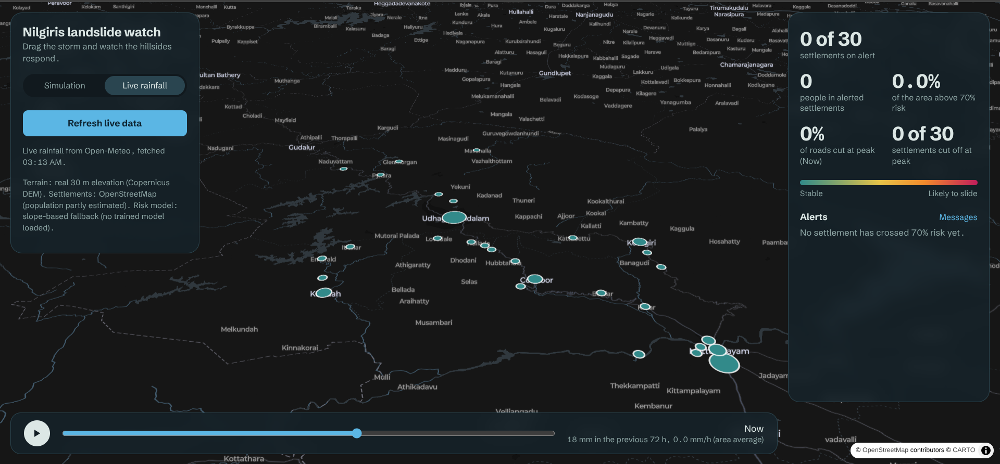
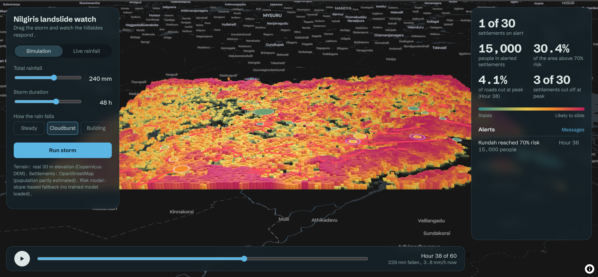
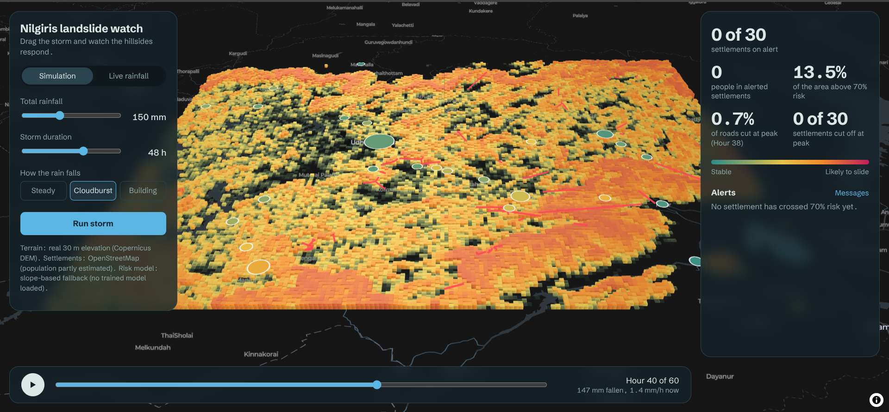
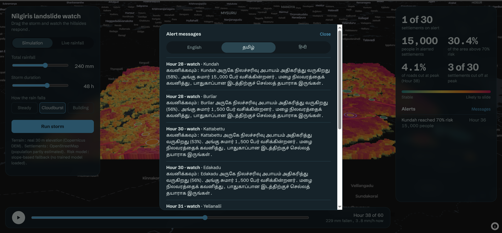

# Landslide early-warning system (Nilgiris, Western Ghats)

A prototype that scores landslide risk for every 250 m cell of the Nilgiris from terrain and rainfall, shows it on a 3D
map, works out which roads would be cut and which settlements stranded, and drafts alerts in English, Tamil and Hindi.
Built for Y-Hack'26 Challenge 24 (AI-Powered Landslide Early Warning and Monitoring System).



## What it does
- **Live and simulated rainfall.** Live mode pulls the past 7 days and a 3-day forecast from Open-Meteo. The simulator makes a storm from sliders (total rainfall, duration, steady, cloudburst or building). Both go through the same pipeline.
- **Real terrain.** Copernicus 30 m elevation, turned into slope, aspect and curvature, summarised on a 250 m grid (133 x 174 = 23,142 cells).
- **Risk = susceptibility x rainfall trigger.** Susceptibility says how landslide-prone the ground is; the trigger compares recent rain with the Caine (1980) global threshold (103 mm in 24 h, 201 mm in 72 h). The result is a relative risk index from 0 to 1, not a calibrated probability.
- **Impact.** Road segments at or above 70% risk are cut from the real OpenStreetMap road network (8,457 junctions, 20,878 segments, 59 hospitals), then settlements that can no longer reach a hospital are marked cut off.
- **Alerts.** Watch (50%), warning (70%) and emergency (85%) levels, one alert per level per settlement, text in English, Tamil and Hindi. Telegram sending is a dry run unless explicitly enabled.

| 240 mm storm at its peak | 150 mm storm at its peak |
|---|---|
|  |  |



## Results, honestly
| Item | Result |
|---|---|
| Learned susceptibility (frequency ratio, 13 usable landslide cells, spatial cross-validation) | AUC 0.36 +/- 0.08, slope-only baseline 0.48 +/- 0.09. **No skill (0.5 is chance), so it is not used.** |
| What the dashboard uses instead | Slope percentile rank as susceptibility, times the published rainfall trigger |
| Rainfall trigger against 22 recorded Nilgiris landslide days | 0 of 22 reached the threshold in ERA5 rainfall (median 0.11x). Not validated locally, so the published value is kept |
| 200 mm cloudburst on the real road network | 29% of the area above 70% risk, 3.8% of roads cut, 3 of 30 settlements cut off |
| Automated tests | 55 passing |

Likely reasons for the weak validation: only 13 usable events, a news-reported inventory biased towards roads and railways,
and locations accurate to 1-5 km against 250 m cells. Full numbers: `docs/MODEL_RESULTS.md`, `docs/results/`, `docs/REPORT_OUTLINE.md`.

## What is real and what is not
| Real | Estimated or not validated |
|---|---|
| Elevation, rainfall (modelled, hourly), NASA landslide inventory, road network, hospitals, settlement positions | Populations (guessed by settlement type when OpenStreetMap has none) |
| Terrain features, rainfall totals, road cutting and cut-off logic (tested) | The risk index itself has not been validated against landslides |
| | No field reports, sensors or offline mode |

A decision-support prototype, not a certified warning system.

## Run
```
python3 -m venv .venv && source .venv/bin/activate
pip install -r requirements.txt
uvicorn api.main:app --reload       # open http://localhost:8000
pytest                              # 55 tests
```
The dashboard works without the data steps below, using synthetic terrain and placeholder settlements. For the real thing
(each step needs internet; raw data and caches stay out of git):
```
pip install -r requirements-terrain.txt -r requirements-roads.txt
python -m scripts.build_terrain --region nilgiris         # real 30 m terrain
python -m scripts.build_roads --region nilgiris           # road network and hospitals
python -m scripts.build_villages --region nilgiris        # real settlements
python -m scripts.train_susceptibility --region nilgiris  # needs data/raw/landslides.csv (NASA Global Landslide Catalog)
python -m scripts.check_trigger --region nilgiris         # rainfall trigger against real events
```
Telegram: set `EWS_ALERTS_SEND=1`, `TELEGRAM_BOT_TOKEN` and `TELEGRAM_CHAT_ID`. Otherwise nothing is sent.

## Layout
| Folder | Job |
|---|---|
| `config/` | Region boxes and global settings |
| `src/terrain/` | Grid, elevation sources, slope, aspect, curvature, caching |
| `src/rainfall/` | Storm simulator, live Open-Meteo source, rolling totals, interpolation |
| `src/model/` | Susceptibility, rainfall trigger, `predict_risk()`, evaluation |
| `src/exposure/` | Settlements (placeholders or cached OpenStreetMap villages) |
| `src/roads/` | Road graph, cutting and isolation logic |
| `src/alerts/` | Alert levels, English/Tamil/Hindi messages, Telegram sender |
| `src/impact.py` | Joins risk to roads cut, settlements stranded and the alert timeline |
| `api/`, `static/` | HTTP routes and the browser dashboard |
| `scripts/`, `tests/`, `docs/` | One-off steps, automated checks, report and demo notes |

## Team
- Terrain, rainfall, risk model, dashboard, integration: Aathi Krishnan M
- Alerts (`src/alerts/`): Logesh S
- Road-network cascade (`src/roads/`): Karthik S
- Report and demo notes (`docs/`): Ragul S

## Data and credits
NASA Global Landslide Catalog; Copernicus DEM GLO-30; Open-Meteo (ERA5 and forecast); OpenStreetMap contributors;
Caine (1980) rainfall thresholds; CARTO basemap. Built with FastAPI, NumPy, rasterio, networkx, osmnx, MapLibre GL and deck.gl.
